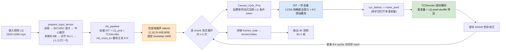
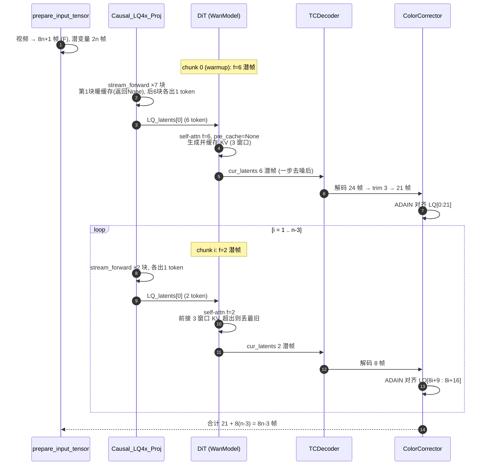
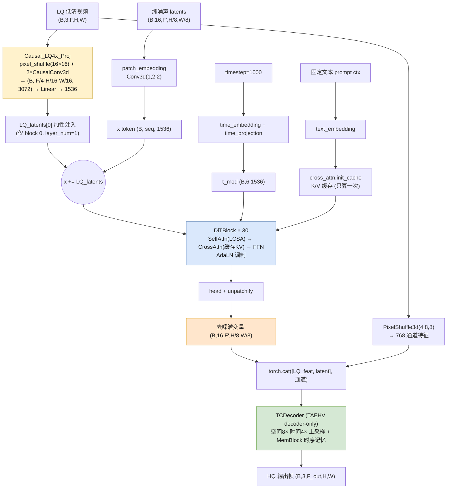
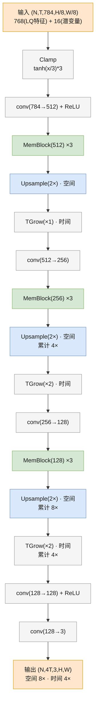
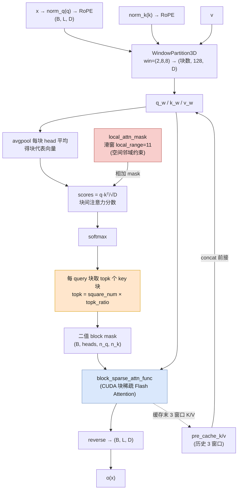
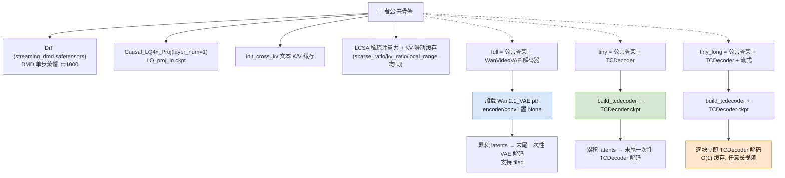

# FlashVSR v1.1 `infer_flashvsr_v1.1_tiny_long_video.py` 推理过程与原理深度分析

> 目标文件：`examples/WanVSR/infer_flashvsr_v1.1_tiny_long_video.py`
> 涉及源码：`diffsynth/pipelines/flashvsr_tiny_long.py`、`diffsynth/models/wan_video_dit.py`、`examples/WanVSR/utils/utils.py`、`examples/WanVSR/utils/TCDecoder.py`

---

## 1. 总览：这是什么

FlashVSR 是 **一步式（one-step）、流式（streaming）扩散视频超分（VSR）** 框架。输入低分辨率视频 LQ，输出 4× 超分视频 HQ。论文三大技术支柱：

1. **三步蒸馏**（三阶段训练）→ 得到一个**单步**可用的扩散模型（DMD 蒸馏）；
2. **局部约束稀疏注意力 LCSA**（Locality-Constrained Sparse Attention）→ 削减冗余计算并弥合训练/测试分辨率差距；
3. **tiny 条件解码器 TCDecoder** → 加速重建。

本脚本是其中 **"tiny + long"** 版本：

- **tiny**：用极小的自编码器解码器 `TCDecoder`（TAEHV）代替完整的 WanVideo VAE 解码器；
- **long**：用**流式/自回归**方式逐块生成并**逐块解码**，KV 缓存 + 因果卷积缓存跨块延续，实现对任意长度视频的 **O(1)（相对视频长度）显存/缓存** 处理。

实测 DiT 为 **Wan2.1-1.3B 架构**（`dim=1536, num_heads=12, num_layers=30, ffn_dim=8960, patch=(1,2,2), in_dim=16, out_dim=16, text_dim=4096, freq_dim=256`），被蒸馏为一步生成。

### 1.1 端到端流程图



---

## 1.2 流式 chunk 划分时序图



---

## 2. 顶层执行流程（`main()`）

```python
pipe = init_pipeline()          # 加载模型 + 组装管线
for p in inputs:
    LQ, th, tw, F, fps = prepare_input_tensor(p, scale=2.0)   # 读帧/缩放/裁剪/对齐
    video = pipe(LQ_video=LQ, num_frames=F, height=th, width=tw, ...)
    video = tensor2video(video)   # [-1,1] -> 0..255 PIL
    save_video(...)
```

### 2.1 `init_pipeline()` 做了什么

1. `ModelManager(torch_dtype=bfloat16, device="cpu")` 建立模型管理器；
2. `mm.load_models([".../diffusion_pytorch_model_streaming_dmd.safetensors"])` 加载被 DMD 蒸馏过的 DiT 权重；
3. `FlashVSRTinyLongPipeline.from_model_manager(...)` 拿到 `dit`（WanModel）与 `vae`（WanVideoVAE，本脚本中只作模型容器使用，解码并不用它）；
4. **挂载 LQ 投影器**：`Causal_LQ4x_Proj(in_dim=3, out_dim=1536, layer_num=1)` 并加载 `LQ_proj_in.ckpt` —— 这是把低清 RGB 视频投影成注入到 DiT 的条件 token 的模块；
5. **构建 tiny 解码器**：`build_tcdecoder(new_channels=[512,256,128,128], new_latent_channels=16+768)` 并加载 `TCDecoder.ckpt`；
6. `enable_vram_management()` 开启显存管理（DiT 权重按需 CPU offload）；
7. `init_cross_kv()`：加载固定文本 prompt 张量，生成并**缓存 cross-attention 的 K/V**；
8. `load_models_to_device(["dit","vae"])`：把需要常驻 GPU 的模型搬上 GPU。

> 注意：`init_cross_kv()` 还顺手把 **时间步固定为 `t=1000`**（`self.timestep=torch.tensor([1000.])`），并预计算时间嵌入 `self.t`、`self.t_mod`。这是"单步生成"的关键：模型被训练/蒸馏成**在 t=1000（纯噪声）上一步直接输出干净潜变量**，推理时不走多步去噪调度。

---

## 3. 数据预处理（`prepare_input_tensor`）

输入是 1080p 视频（`1920×1080`），`scale=2.0`（超分 2×）。

1. 逐帧读出，得到原始分辨率 `w0×h0`；
2. `compute_scaled_and_target_dims`：目标尺寸 `sW = w0*2`、`sH = h0*2`，再向下对齐到 128 的倍数 `tW/tH`；
3. **帧对齐到 8n+1**：
   ```python
   idx = list(range(total)) + [total-1]*4     # 末尾复制 4 帧
   F = largest_8n1_leq(len(idx))              # 取 ≤ len 的最大的 8n+1
   ```
   最终 `F = 8n+1`，实际有效输出帧为 `8n-3`（打印 "Target Frames (8n-3)"，即 `F-4`）。
4. 每帧 `upscale_then_center_crop`（双三次放大 + 中心裁剪到 tW×tH）；
5. `pil_to_tensor_neg1_1`：RGB→CHW，`x/255*2-1` 归一到 `[-1,1]`，转 bfloat16；
6. `vid = stack.permute(1,0,2,3).unsqueeze(0)` → 形状 `(1, C, F, H, W)`（BCFHW）。

> 为什么是 8n-3？潜变量时间轴：VAE 时间 4× 下采样、patchify 时间步长 1，LQ 侧每 4 帧投影成 1 个 token。最终输出的帧数需满足 `4k+1` 的 VAE 帧格式，而流式 chunk 以 8 帧为周期，故整体对齐到 `8n+1`，扣掉 4 帧 padding 后输出 `8n-3`。

---

## 4. 模型组件详解

### 4.0 组件数据流架构图



### 4.1 DiT（`WanModel`，`wan_video_dit.py`）

标准 Wan2.1 扩散 Transformer，改造点：

- `patch_embedding = Conv3d(16, 1536, kernel=(1,2,2), stride=(1,2,2))`：潜变量 `(B,16,F,H/8,W/8)` → token 序列 `(B, F·H/16·W/16, 1536)`（空间再 /2）。
- 每个 `DiTBlock`：`modulate(norm1) → SelfAttention → gate → CrossAttention → modulate(norm2) → FFN → gate`，用 6 通道 `t_mod` 做 AdaLN 调制。
- **LQ 条件注入**：`if LQ_latents is not None and block_id < len(LQ_latents): x = x + LQ_latents[block_id]`。即把 LQ 投影得到的 token **逐块加性注入**。`layer_num=1` ⇒ 只注入第 0 块。
- `head`：`Linear(1536, 16·1·2·2=64)` + `unpatchify` 还原成潜变量。

### 4.2 LQ 投影器（`Causal_LQ4x_Proj`，`utils/utils.py`）

把 RGB 低清视频映射为与 DiT token 对齐的条件，结构：

```
pixel_shuffle(ff=1, hh=16, ww=16)   # RGB -> 768 通道，空间 16× 下采样
CausalConv3d(768, 2048, k=(4,3,3), stride=(2,1,1)) + RMSNorm + SiLU   # 时间 /2
CausalConv3d(2048, 3072, k=(4,3,3), stride=(2,1,1)) + RMSNorm + SiLU  # 时间再 /2
Linear(3072, 1536)   # layer_num=1，只一个投影层
```

- 空间：`16×16` patch → 1 token，与 DiT 的 `VAE(8×) × patch(2×) = 16×` 对齐。
- 时间：两段 stride=2 的因果卷积合计 `4×` 下采样 ⇒ **每 4 帧 LQ 对应 1 个潜变量 token**。
- **因果卷积 `CausalConv3d`**：普通 3D 卷积改成"仅看过去"——时间维度只做前向 padding `(2,0)` 并用 `replicate`，同时支持 `cache_x`（跨块滚动缓存，`CACHE_T=2`），实现流式处理时不重复计算。
- `forward`（批式，训练用）与 `stream_forward`（推理用）两套接口。推理逐 4 帧块喂入 `stream_forward`，首块只暖缓存返回 `None`，之后每块输出 1 个 token。

### 4.3 tiny 解码器（`TCDecoder` / `TAEHV`，`utils/TCDecoder.py`）

TCDecoder 就是论文里的 **"tiny conditional decoder"** —— 一个 **decoder-only 的微型时序自编码器（TAEHV）**，替代完整 WanVideoVAE 的解码端，把去噪潜变量 + LQ 条件快速重建回 RGB。

#### 4.3.1 定位与输入输出

```
输入：x    = 去噪潜变量 (N, T, 16, H/8, W/8)   [NTCHW]
      cond = LQ 低清视频 (B, 3, T_lq, H, W)      [BCFHW]
输出：(N, 4T, 3, H, W) → transpose → (N,3,4T,H,W) → *2-1 → [-1,1]
```

- 空间上采样 **8×**（`H/8 → H`），时间上采样 **4×**（`T → 4T`），通道 `784 → 3`。
- 相比 WanVideoVAE（多尺度、encoder+decoder 全量），它只有解码器、且更窄更深，参数量/显存大幅降低。

#### 4.3.2 网络结构（`channels=[512,256,128,128]`，`latent_channels=784`）



外加 `_apply_identity_deepen`：在每个 `ReLU` 后插入 `IdentityConv2d(3×3) + ReLU`（Dirac 初始化，等于恒等，用于"加深"网络）。

#### 4.3.3 关键组件逐个拆解

- **`Clamp`**：`torch.tanh(x/3)*3`，把潜变量软限幅到 `(-3,3)`，稳定训练/推理。
- **`MemBlock(n_in, n_out)`（时序记忆，流式核心）**：
  ```python
  self.conv = Sequential(conv(n_in*2→n_out), ReLU, conv(n_out→n_out), ReLU, conv(n_out→n_out))
  self.skip = Conv1x1(n_in→n_out) if n_in != n_out else Identity()
  def forward(self, x, past):
      return ReLU(self.conv(cat([x, past], 1)) + self.skip(x))
  ```
  把**当前帧特征 x** 与**上一帧特征 past** 在通道维拼接，经 3 层卷积 + 残差。`past` 就是跨帧的**循环记忆**，解码器靠它获得时序连续性。
- **`TGrow(stride)` / `TPool(stride)`（时间上/下采样）**：`TGrow` 用 `Conv1x1(n_f → n_f*stride)` 再拆通道，实现 `1 帧 → stride 帧` 的时间上采样；`TPool` 反向（`stride 帧 → 1 帧`），仅编码端使用。
- **`IdentityConv2d` + 深化（deepening）**：Dirac 初始化的 3×3 卷积，初始等价恒等；`_apply_identity_deepen` 在每个 `ReLU` 后追加 `IdentityConv2d+ReLU`，以"先恒等再加深度"的方式加深网络而不破坏初始收敛。
- **`PixelShuffle3d(4,8,8)`（条件注入，关键设计）**：

  ```python
  rearrange(x, 'b c (f 4) (h 8) (w 8) -> b (c*4*8*8) f h w').transpose(1,2)
    # RGB 3 通道 → 3*4*8*8 = 768 通道，空间 8×、时间 4× 下采样
  ```
  把 LQ 帧打成 `(B, F/4, 768, H/8, W/8)`，**恰好与去噪潜变量时/空分辨率对齐**，再在通道维拼接：
  ```python
    # decode_video 内部
  if cond is not None:
      x = torch.cat([self.pixel_shuffle(cond), x], dim=2)   # 768 + 16 = 784 通道
  ```

  
  > 这是 "conditional" 的由来：解码器不仅看去噪结果，还显式吃进 LQ 条件特征，保证重建忠于输入内容（细节/色彩）。

#### 4.3.4 两种执行模式（`apply_model_with_memblocks`）

| 模式 | `parallel=True` | `parallel=False`（FlashVSR 用） |
|---|---|---|
| 思路 | 把 `(N,T,C,H,W)` 展平成 `(N*T,C,H,W)` 一次跑完全部层 | 工作队列逐帧、逐层推进 |
| MemBlock 的 past | `F.pad` 时间维前移 1 帧（`past=前一帧`，首帧为 0） | 显式 `mem[i]` 保存上一帧该层输出，跨帧持久 |
| 内存/因果 | `O(T)` 显存，非严格流式 | `O(1)` 显存，**严格因果、流式** |

FlashVSR 统一用 `parallel=False`，因为要**逐 chunk 流式解码**：每生成一个 chunk 的潜变量就立即解码，`MemBlock` 的 `mem` 跨 chunk 延续（`clean_mem()` 只在整条视频开始前调用一次）。

#### 4.3.5 因果对齐（`frames_to_trim`）

```python
frames_to_trim = 2**sum(decoder_time_upscale) - 1 = 2**2 - 1 = 3
```
时间 4× 上采样（`TGrow 2× + 2×`）天然引入 **3 帧因果延迟**（类似卷积的 `(k-1)` 因果 padding）。首次解码时裁掉头部 3 帧：

```python
trim_flag = self.mem[-8] is None      # 仅首次调用时 mem 全为 None
...
if trim_flag:
    return x[:, self.frames_to_trim:]
```
- 首块：`6 潜帧 → 24 帧 → trim 3 → 21 帧`；
- 后续块：`2 潜帧 → 8 帧`（不再 trim）。

这就是第 5 节帧计数公式里 "21 而非 24" 的来源。

#### 4.3.6 在 FlashVSR 里的接线

```python
# infer_flashvsr_v1.1_tiny_long_video.py
multi_scale_channels = [512, 256, 128, 128]
pipe.TCDecoder = build_tcdecoder(new_channels=multi_scale_channels, new_latent_channels=16+768)
pipe.TCDecoder.load_state_dict(torch.load("./FlashVSR-v1.1/TCDecoder.ckpt"), strict=False)
...
pipe.TCDecoder.clean_mem()   # 整条视频开始时清空时序记忆
...
cur_frames = pipe.TCDecoder.decode_video(cur_latents.transpose(1,2),
                                         parallel=False, cond=LQ_video[...]).transpose(1,2).mul_(2).sub_(1)
```
- `new_latent_channels=16+768` 对应 `cat([LQ特征768, 潜变量16])` 的通道数；
- `strict=False` 允许部分 key 缺失（`patch_tgrow_layers` 会裁剪 TGrow 多余通道以适配）；
- `.mul_(2).sub_(1)` 把 `[0,1]` 输出转回 `[-1,1]` 与管线其他模块对齐。

#### 4.3.7 与 WanVideoVAE 解码器对比（"full" vs "tiny"）

| | WanVideoVAE decoder（full） | TCDecoder（tiny/tiny_long） |
|---|---|---|
| 结构 | 完整多尺度编码-解码 VAE 的解码端 | 仅解码器的轻量时序自编码器 |
| 条件 | 无（纯潜变量重建） | 显式 concat LQ 特征（768 通道） |
| 时序建模 | 3D 卷积 | `MemBlock` 循环记忆（流式友好） |
| 支持 tiled | 是 | 否 |
| 速度 | 慢 | 快（"accelerates reconstruction without sacrificing quality"） |

> 一句话：**TCDecoder = 把 VAE 解码器换成一个「吃 LQ 条件、带循环时序记忆、可流式运行」的微型解码器**，是 FlashVSR "tiny" 变体提速、以及 "long" 变体逐块流式解码能成立的硬件基础。

### 4.4 Cross-Attention KV 缓存

`CrossAttention.init_cache(ctx)` 把文本上下文（经 `text_embedding`）一次性算出 K/V 并缓存到 `cache_k/cache_v`，此后所有 chunk、所有时间帧复用同一份文本 K/V——因为超分任务文本恒定，cross-attn 无需反复重算。

---

## 5. 流式推理机制（`FlashVSRTinyLongPipeline.__call__`）

### 5.1 关键变量

```python
noise: (1, 16, (num_frames-1)//4, H//8, W//8)   # num_frames=F=8n+1 => 潜变量时间帧 = 2n
latents = noise                                  # 单步生成：直接从纯噪声出发
process_total_num = (num_frames-1)//8 - 2 = n-2  # 总 chunk 数
```

### 5.2 逐块循环（streaming）

每个 `cur_process_idx` 迭代处理 **2 个潜变量帧**（首块为 6 帧做 warmup）：

| 迭代 | cur_latents 潜变量帧 | LQ 条件帧范围 | 输出帧 |
|---|---|---|---|
| 0（warmup） | `latents[:, :, :6]`（6 帧） | 0..20（21 帧，暖缓存 1 帧 + 6 token） | 6×4−3 = **21** |
| i≥1 | `latents[:, :, 4+2i : 6+2i]`（2 帧） | `8i+9 .. 8i+16`（8 帧） | 2×4 = **8** |

总输出 = `21 + 8(n-3) = 8n-3 = F-4` 帧。

### 5.3 LQ 条件流式喂入

`LQ_proj_in.stream_forward(clip)` 逐 4 帧块调用：

- 首块（`inner_loop_num=7`）：`clip = LQ[:, max(0,4k-3):4(k+1)-3]`，k=0..6。第 0 块暖缓存返回 `None`，之后 6 块各出 1 token，拼成 `LQ_latents[0]`（`(B, 6·h·w, 1536)`）；
- 后续块（`inner_loop_num=2`）：`clip = LQ[:, 8i+17+4k : 8i+21+4k]`，k=0..1，各出 1 token，拼成 2 token。

### 5.4 自注意力 KV 缓存（跨块时序上下文）

`SelfAttention` 以 `win=(2,8,8)` 划窗口，`pre_cache_k/v` 保存**过去若干时间窗口的 K/V**：

```python
if pre_cache_k is not None:
    k_w = cat([pre_cache_k, k_w], 0)      # 前接历史
...
cache_num = cur_block_n // one_len         # 当前 K 的时间窗口数
cache_k = k_w[one_len:] if cache_num > kv_len else k_w   # 超出 kv_len 则丢最旧窗口
```

- `kv_len = int(kv_ratio) = 3` ⇒ 保留最近 **3 个时间窗口 = 6 个潜变量帧 = 24 个输出帧** 的自注意力 KV 作为时序上下文。
- 首块约束：`is_stream` 且无 cache 时 `assert f==6`；后续有 cache 时 `assert f==2`。即**首块 6 帧、后续每块 2 帧**。

### 5.5 单步去噪4.3.2 网络结构

```python
noise_pred_posi, pre_cache_k, pre_cache_v = model_fn_wan_video(dit, x=cur_latents, timestep=1000, ...)
cur_latents = cur_latents - noise_pred_posi     # 一步从噪声得到干净潜变量
```

不是标准的多步 `scheduler.step`，而是**固定 t=1000 一步回归**：DMD 蒸馏让模型在纯噪声点上直接预测干净样本。

### 5.6 逐块解码（long 的关键）

```python
cur_frames = self.TCDecoder.decode_video(
    cur_latents.transpose(1,2), parallel=False,
    cond=LQ_video[:,:,LQ_pre_idx:LQ_cur_idx]).transpose(1,2).mul_(2).sub_(1)
frames_total.append(cur_frames.to('cpu'))   # 立即累积"帧"而非"潜变量"
```

对比 `tiny`（非 long）：`tiny` 先把所有 `cur_latents` 收进 `latents_total`，**最后统一解码一次**；`tiny_long` 则**每块立即解码**并累积帧。这样对超长视频只需维持固定大小的缓存，不随视频长度增长。

### 5.7 颜色校正（`TorchColorCorrectorWavelet`，method='adain'）

对去噪输出做**逐块**色彩对齐：以 LQ 帧为风格参考，用 ADAIN（`_adain`）把 HQ 的均值和方差对齐到 LQ，避免扩散生成引入的色偏。默认还提供 `wavelet` 方案（`_wavelet_reconstruct`：保留 HQ 高频 + 用 LQ 低频替换）。

---

## 6. LCSA：局部约束稀疏注意力（核心提速点）

### 6.1 位置编码与窗口划分

- 3D RoPE（帧/高/宽三维频率拼接，head_dim=128 拆成 44/42/42）。
- `WindowPartition3D.partition(q, (2,8,8))`：把 token 序列重排成 `(块数, 2·8·8=128, dim)` 的窗口块。每个块 128 token。

### 6.2 稀疏 mask 生成（`generate_draft_block_mask`）

用**块级廉价估计**选出需要真正计算的 (query 块, key 块) 对：

1. 对每个块的 Q/K 做 **head 平均**（`avgpool dim=1`）得到块代表向量；
2. `scores = einsum("hld,hmd->hlm", q_heads, k_heads)/sqrt(D)` 得到块间注意力分数；
3. 叠加**局部空间 mask**（`build_local_block_mask_shifted_vec_normal_slide(h//8, w//8, local_range, local_range)`：滑窗，窗口边长 `local_range=11`，约束注意力只在空间邻域内）；
4. `softmax` 后按行取 **topk** 个最大块（`apply_topk = min(N-1, topk)`），得到二值 block mask。

其中：

```python
window_size = win[0]*h*w//128            # = 空间窗口数 = h*w/64
square_num  = window_size * window_size
topk        = int(square_num * topk_ratio) - 1
```

`topk_ratio` 在 `main()` 里做**分辨率归一化**：

```python
topk_ratio = sparse_ratio * 768*1280 / (th*tw)
```

即以 768×1280 为基准，随分辨率升高等比缩小 topk，保持被选中块数量大致恒定，从而**弥合训练/测试分辨率差距**。

### 6.3 LCSA 流程图



### 6.4 实际注意力

`flash_attention` 检测到 `attention_mask`（即上述 block mask）时，调用 CUDA 扩展 `block_sparse_attn_func`（MIT Han Lab 的 Block-Sparse-Attention 库）做**块稀疏 Flash Attention**，只计算 mask 为 True 的块对。这就是 README 强调的、第三方实现常缺失、缺失后会明显掉质的 LCSA 模块。

### 6.5 两个稀疏度旋钮

| 参数 | 作用 | 脚本取值 |
|---|---|---|
| `local_range` | 局部滑窗边长（局部性约束强弱） | 11（9→更锐，11→更稳） |
| `topk_ratio` / `sparse_ratio` | 每个 query 块保留的 key 块数（稀疏度） | `sparse_ratio=2.0` |

---

## 7. 显存管理（`enable_vram_management`）

对 DiT 中 `Linear / Conv3d / LayerNorm / RMSNorm` 做 **AutoWrapped** 包装，实现参数级 **CPU↔GPU 按需搬移**（`onload/offload`），配合 `load_models_to_device(["dit","vae"])` 手动切换常驻/离驻模型。这使 1.3B 模型可在单卡上运行，并为超长视频流式推理腾出显存给 KV 缓存与 TCDecoder 时序记忆。

---

## 8. 关键超参数速查（本脚本）

| 参数 | 值 | 含义 |
|---|---|---|
| `scale` | 2.0 | 超分倍数（输入 1080p → 输出 ~4K） |
| `seed` | 0 | 噪声种子 |
| `dtype` | bfloat16 | 计算精度 |
| `num_inference_steps` | 1 | 单步生成（DMD） |
| `cfg_scale` | 1.0 | 必须为 1（无 classifier-free guidance） |
| `timestep` | 1000 | 固定（纯噪声一步回归） |
| `is_full_block` | False | 使用 LCSA 稀疏注意力（非全块密集） |
| `if_buffer` | True | 噪声时间帧 = `(F-1)//4` |
| `sparse_ratio` | 2.0 | 稀疏度（1.5 更快 / 2.0 更稳） |
| `kv_ratio` | 3.0 | 自注意力 KV 缓存的窗口数（=3 窗口=6 潜帧=24 输出帧） |
| `local_range` | 11 | LCSA 局部滑窗边长 |
| `color_fix` | True | 逐块 ADAIN 色彩校正 |

---

## 9. 三脚本详细对比（v1.1 系列）

对比对象：

- `infer_flashvsr_v1.1_full.py`（下称 **full**）
- `infer_flashvsr_v1.1_tiny.py`（下称 **tiny**）
- `infer_flashvsr_v1.1_tiny_long_video.py`（下称 **tiny_long**）

### 9.1 三者关系图



### 9.2 相同点（三者完全一致的部分）

1. **权重与路径**：均使用 v1.1 权重，目录 `./FlashVSR-v1.1/`。
2. **DiT**：均加载 `diffusion_pytorch_model_streaming_dmd.safetensors`（被 DMD 蒸馏为单步生成的 Wan2.1-1.3B DiT）。
3. **LQ 投影器**：均挂载 `Causal_LQ4x_Proj(in_dim=3, out_dim=1536, layer_num=1)` 并加载 `LQ_proj_in.ckpt`。注意 v1.1 的 full **也**统一为 `Causal` 版（旧版 `infer_flashvsr_full.py` 才用 `Buffer_LQ4x_Proj`）。
4. **初始化流程**：`ModelManager(torch_dtype=bfloat16, device="cpu")` → `enable_vram_management(num_persistent_param_in_dit=None)` → `init_cross_kv()`（固定 `timestep=1000`）→ `load_models_to_device(["dit","vae"])`。
5. **推理超参数**：`cfg_scale=1.0`、`num_inference_steps=1`、`seed=0`、`is_full_block=False`、`if_buffer=True`、`sparse_ratio=2.0`（`topk_ratio = sparse_ratio*768*1280/(th*tw)`）、`kv_ratio=3.0`、`local_range=11`、`color_fix=True` —— 三者完全相同。
6. **预处理**：`8n+1` 帧对齐、末尾补 4 帧、BICUBIC 放大 + 中心裁剪、`[-1,1]` 归一化，逻辑一致。
7. **输出**：帧数均为 `8n-3`，命名 `FlashVSR_v1.1_{Type}_{name}_seed{seed}.mp4`。

### 9.3 不同点总表

| 维度 | full | tiny | tiny_long |
|---|---|---|---|
| Pipeline 类 | `FlashVSRFullPipeline` | `FlashVSRTinyPipeline` | `FlashVSRTinyLongPipeline` |
| 额外加载的权重 | `Wan2.1_VAE.pth` | 无 | 无 |
| 解码器 | WanVideoVAE 解码器（`encoder`/`conv1` 置 None） | TCDecoder | TCDecoder |
| 解码时机 | 累积全部 latents，末尾一次性解码 | 累积全部 latents，末尾一次性解码 | **逐块立即解码** |
| tiled 分块解码 | 支持（脚本传 `tiled=False`） | 不支持（`tiled` 参数存在但未使用） | 不支持（同上） |
| 颜色校正 `chunk_size` | 16 | 16 | None（逐块） |
| 潜变量内存 | 随视频长度线性增长 | 随视频长度线性增长 | **O(1)（逐块用完即弃）** |
| 默认 `scale` / 输入 | 4 / `example0-3.mp4` | 4 / `example0-3.mp4` | 2 / `1080p.mp4` |
| `compute_scaled` 实现 | `int` scale + `max(multiple,…)` | `float` scale + `round` + 校验 | `float` scale + `round` + 校验 |
| 适用场景 | 高质量、固定/较短长度 | 更快、固定/较短长度 | 任意长视频、流式输出 |

### 9.4 逐项详解

**（1）解码器：full 用 VAE，tiny/tiny_long 用 TCDecoder —— 这是 "tiny" 的本质含义**

- `full`：加载完整 `Wan2.1_VAE.pth`，把编码器置 `None`（`pipe.vae.model.encoder = None`、`pipe.vae.model.conv1 = None`）仅保留解码端，最后用 `self.vae.decode(...)` 重建。质量上限最高，但解码重、且支持 `tiled` 分块缓解显存。
- `tiny` / `tiny_long`：完全不加载 VAE，用 `build_tcdecoder(new_channels=[512,256,128,128], new_latent_channels=16+768)` 构建一个**解码器专用的小型时序自编码器**（`TAEHV`），加载 `TCDecoder.ckpt`。这是论文的"tiny conditional decoder"，用很小的参数量完成潜变量 → RGB 重建。
- 二者都会在 `fetch_models` 里把 `self.vae` 挂到 `model_names`，但 tiny/tiny_long 的 `__call__` 从不调用 `self.vae`，属于"占位"，仅 full 真正用到 VAE 解码。

**（2）解码时机：tiny_long 独有的流式解码 —— 这是 "long" 的本质含义**

- `full` / `tiny`：循环内只累积 `latents_total.append(cur_latents)`，**循环结束后**一次性 `torch.cat` + 解码。
- `tiny_long`：循环内每生成一个 chunk 的干净潜变量，**立即** `TCDecoder.decode_video(...)` 解码并 `frames_total.append(cur_frames.to('cpu'))`，只保留"帧"不保留"潜变量"。因为 DiT 的 self-attn KV 缓存与 TCDecoder 的 `MemBlock` 时序记忆都是滚动式，所以缓存占用不随视频长度增长，可处理任意长的视频。

**（3）颜色校正的粒度差异**

- `full` / `tiny`：整段解码后，用 `chunk_size=16` 分块做 ADAIN 校色（因为此时已得到完整帧序列）。
- `tiny_long`：`chunk_size=None`，对当前 chunk 的帧直接做 ADAIN，与流式解码粒度一致。

**（4）默认输入与 scale**

- `full` / `tiny` 面向 4× 超分（`scale=4`），默认跑 `example0-3.mp4`。
- `tiny_long` 面向长视频 demo，默认 `scale=2` 跑 `1080p.mp4`。

**（5）`compute_scaled_and_target_dims` 实现细节**

- `full`：`scale` 为 `int`，`sW = w0*scale`，并对目标尺寸做 `max(multiple, …)` 兜底。
- `tiny` / `tiny_long`：`scale` 为 `float`，`sW = int(round(w0*scale))`，并增加"缩放后过小/目标超过缩放尺寸"的显式异常校验，更健壮。

### 9.5 一句话区分

> 三者共享同一套"**DMD 单步 DiT + Causal LQ 投影 + LCSA + 文本 KV 缓存**"推理核心；差异只在**解码端**（VAE vs TCDecoder）与**解码时机**（末尾一次性 vs 逐块流式）：`full` = 质量优先、`tiny` = 速度优先、`tiny_long` = 流式/长视频优先。

---

## 10. 一句话总结

`infer_flashvsr_v1.1_tiny_long_video.py` 把视频切成以 8 帧为周期的 chunk，用**固定 t=1000 的一步 DMD 蒸馏 DiT** 逐块从纯噪声回归出干净潜变量；LQ 帧经**因果卷积 LQ 投影器**流式注入 DiT 首块作为条件；自注意力靠 **KV 滑动缓存（3 窗口）** 维持跨块时序上下文、靠 **LCSA 块稀疏注意力** 削减计算；每个 chunk 的潜变量连同 LQ 条件一起交给**带时序记忆的 tiny 解码器 TCDecoder 立即解码**，最终逐块 ADAIN 校色后拼接成完整 4K 输出——从而以近似实时、恒定缓存实现超长视频的超分。
